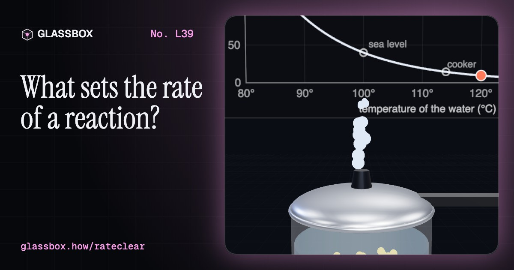
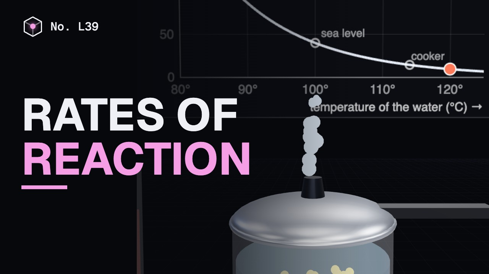
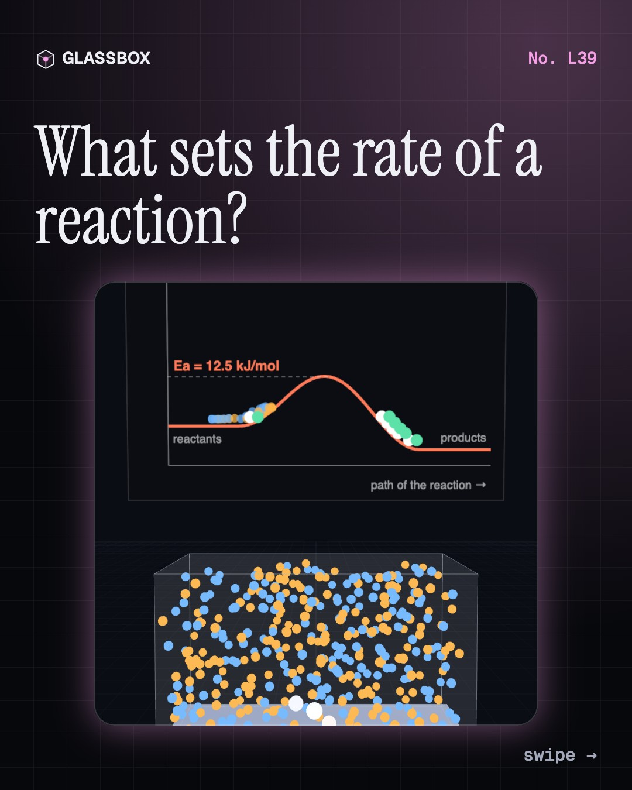
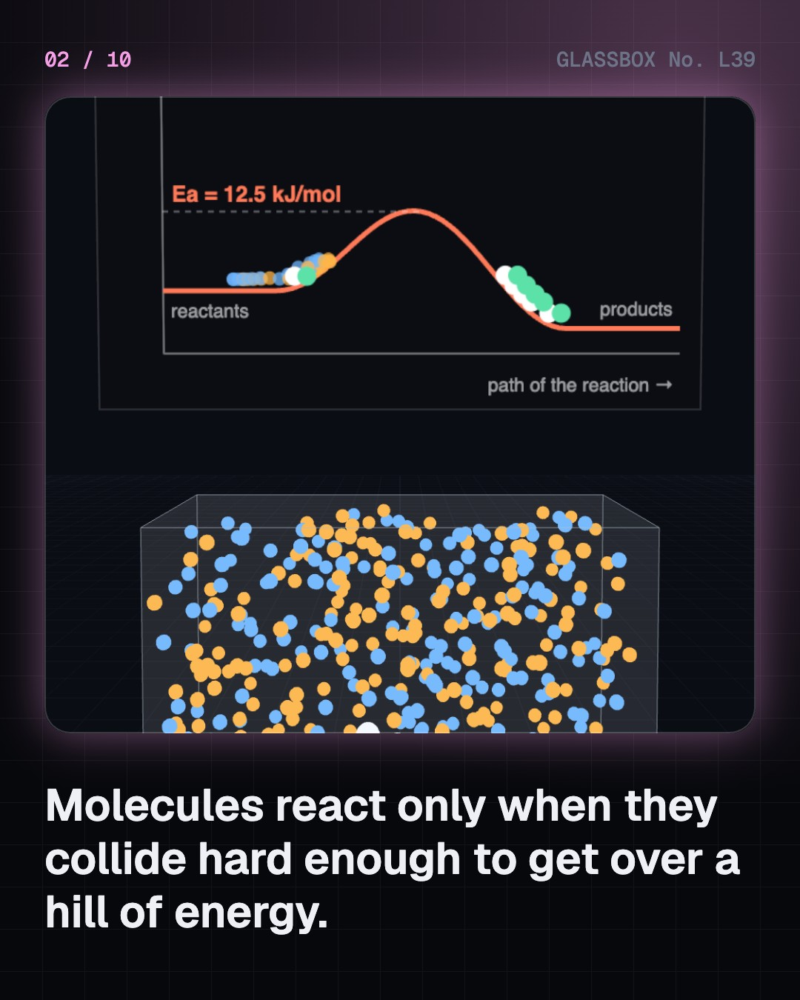
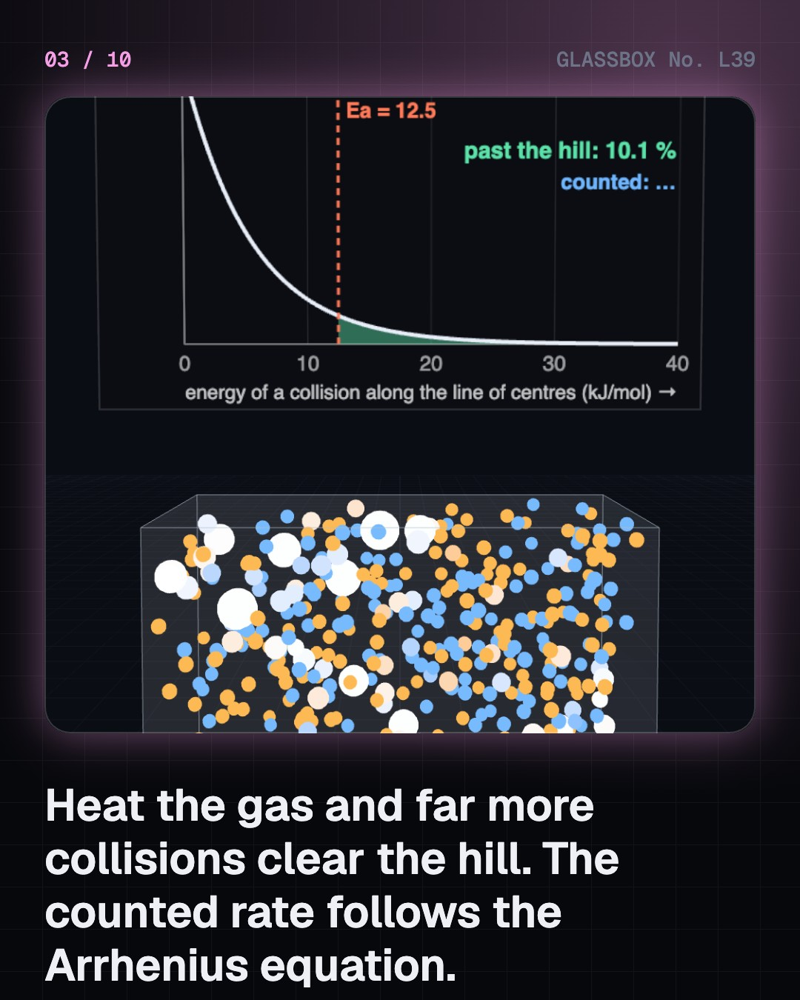
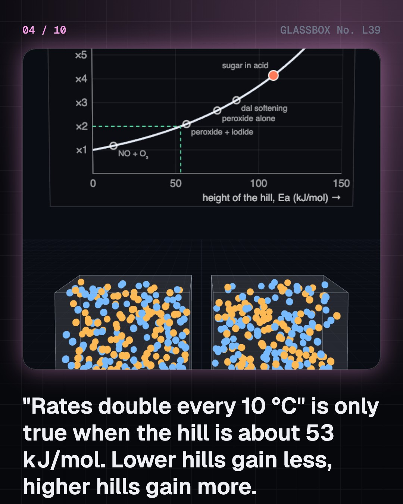

<!-- glassbox:start -->
<!-- Generated from glassbox.json by the Glassbox hub (npm run readme -- rateclear). Edit glassbox.json, not this block. -->
<p align="center"><a href="https://glassbox.how/e/rateclear/"></a></p>

<h1 align="center">Rates of reaction</h1>

<p align="center"><b>What sets the rate of a reaction?</b><br>A tank of 400 molecules collides hundreds of times a second and counts every reaction, and the count lands on the Arrhenius equation. Test the "doubles every 10 °C" rule and find the one hill for which it is true. Then cook dal in Leh, powder marble, clean a car's exhaust with platinum and ask why diamonds last.</p>

<p align="center"><a href="https://glassbox.how/rateclear/"><b>▶ Play with it</b></a> &nbsp;·&nbsp; <a href="https://glassbox.how/e/rateclear/">Read the 60-second explainer</a> &nbsp;·&nbsp; <a href="https://glassbox.how/rateclear/glassbox/reel.mp4">Watch the 40-second video</a></p>

<p align="center">
  <a href="https://glassbox.how/e/rateclear/"></a>
  <a href="https://glassbox.how/e/rateclear/"></a>
  <a href="LICENSE"></a>
  <a href="LICENSE-CONTENT.md"></a>
  <a href="#privacy"></a>
</p>

## In 60 seconds

1. **Collide hard enough.** Molecules react only when they collide with at least the activation energy Ea, and the right way round. At 27 °C just 0.67 % of collisions clear a 12.5 kJ/mol hill. A tank of 400 molecules counts its own reactions, and the count matches collisions × e^(−Ea ÷ RT).
2. **A few degrees, a big change.** "Rates double every 10 °C" is exact only for a hill of 53 kJ/mol near room temperature. A 12.5 kJ/mol hill gains 18 %, a 106 kJ/mol hill gains four times. That is why a fridge at 4 °C slows spoiling about 20 times, and a pressure cooker at 120 °C cooks dal four times faster than a pot at 100 °C.
3. **Only the surface reacts.** A solid can be hit only at its surface. Powdered marble gives off its 96 cm³ of gas in seconds, chips in minutes, and the slope of the gas curve is the rate. One litre of solid ground to flour has 120 m² of surface, so dust clouds are a fire hazard. Damp, salty air rusts steel many times faster than dry air.
4. **A lower path over the hill.** A catalyst offers another route with a lower hill and comes out unchanged. Hydrogen peroxide's hill drops from 75 kJ/mol to 56.5 with iodide and to about 8 with the enzyme catalase. Platinum cleans car exhaust, and iron makes ammonia for fertiliser. A catalyst changes how fast, never how much.
5. **Where the simple rules stop.** A rate is not one number: it falls as the reactants run out, and a tangent to the curve reads it at any moment. Living things break the Arrhenius rule: above about 45 °C curd bacteria slow down because their enzymes unfold. And a downhill reaction can still be too slow to see: diamond should turn to graphite, but its hill of about 730 kJ/mol means it never does at room temperature.

## Words worth knowing

| Term | Meaning |
|---|---|
| **Rate of reaction** | How fast reactants are used up or products are made: the change in amount divided by the time taken. |
| **Collision theory** | Particles react only when they collide with enough energy and the right way round. |
| **Activation energy (Ea)** | The least energy a collision needs to react: the height of the hill between reactants and products, in kJ per mole. |
| **Arrhenius equation** | k = A × e^(−Ea ÷ RT). It says how the rate constant k depends on the hill Ea and the temperature T in kelvin. |
| **Maxwell–Boltzmann spread** | The range of speeds of molecules at one temperature. Only the fast tail has enough energy to react, and heating fattens that tail. |
| **Catalyst** | A substance that speeds a reaction by opening a path with a lower hill. It is not used up, and it does not change how much product forms. |
| **Enzyme** | A protein that works as a catalyst in living things. Each one fits a particular molecule, and it stops working if heat unfolds it. |
| **Tangent** | A straight line that just touches a curve. On a graph of amount against time, its gradient is the rate at that moment. |

## A short history

**From an exploding flour store in Turin to laser flashes that catch a bond as it breaks.**

- **1835** · Berzelius gives it a name: catalysis (Jöns Jacob Berzelius, Stockholm)
- **1850** · The first reaction to be timed (Ludwig Wilhelmy, Heidelberg)
- **1884** · Studies in chemical dynamics (Jacobus van 't Hoff, Amsterdam)
- **1889** · Arrhenius and the energy hill (Svante Arrhenius, Leipzig)
- **1909** · A Nobel Prize for catalysis (Wilhelm Ostwald, Stockholm)
- **1909** · The search for a catalyst that could feed the world (Alwin Mittasch, with Carl Bosch and Fritz Haber, Ludwigshafen and Oppau)
- **1916** · Collision theory, twice (Max Trautz and William Lewis, Heidelberg and Liverpool)
- **1973** · The converter that went into every car (Carl Keith, John Mooney and colleagues at Engelhard, New Jersey)

The full story, with 21 moments, charts, people and 43 sources: [glassbox.how/e/rateclear/history](https://glassbox.how/e/rateclear/history/). The data lives in [`history.json`](history.json).

## Video and slides

Made with the Glassbox studio from this box's storyboard (`window.glassbox.director`). Free to reuse under CC BY 4.0.

<a href="https://glassbox.how/rateclear/glassbox/video.mp4"></a>

<p><a href="glassbox/slide-1.jpg"></a> <a href="glassbox/slide-2.jpg"></a> <a href="glassbox/slide-3.jpg"></a> <a href="glassbox/slide-4.jpg"></a></p>

| File | What | Size |
|---|---|---|
| [`glassbox/reel.mp4`](https://glassbox.how/rateclear/glassbox/reel.mp4) | Reel / Short, with captions and soundtrack | 1080×1920 |
| [`glassbox/video.mp4`](https://glassbox.how/rateclear/glassbox/video.mp4) | YouTube video, with captions and soundtrack | 1920×1080 |
| `glassbox/slide-1…10.jpg` | Instagram carousel | 1080×1350 |
| `glassbox/thumb.jpg` | YouTube thumbnail | 1280×720 |
| `glassbox/cover.jpg` | Share card and repo social preview | 1200×630 |
| [`glassbox/history-reel.mp4`](https://glassbox.how/rateclear/glassbox/history-reel.mp4) | “History in 10 moments” Reel / Short | 1080×1920 |
| `glassbox/history-slide-*.jpg` | History carousel | 1080×1350 |
| `glassbox/post.json` | Post copy and schedule used by the publish kit | |

## Privacy

This box has no accounts and no ads, and it ships its own fonts and libraries. When you run it yourself it sends nothing anywhere. On glassbox.how, the site's `/bar.js` also loads Glassbox's analytics: **Google Analytics** to count visits (it asks first in the EU, UK and Switzerland, and stays off when your browser sends Global Privacy Control or Do Not Track) and **ClickTrust** to detect bots.

It remembers a few things **in your own browser only**, and never sends them anywhere:

| Browser storage key | What it holds |
|---|---|
| `rateclear.v1` | Which chapters you have opened, your best quiz scores, and sound on or off. |

Exactly what each one sees is at [glassbox.how/privacy](https://glassbox.how/privacy/).

## Licences

- **Code:** [MIT](LICENSE). Use it, change it, ship it.
- **Explanations, text, images and videos** (`glassbox.json`, `glassbox/`): [CC BY 4.0](LICENSE-CONTENT.md). Credit “Glassbox, glassbox.how/e/rateclear”.
- **Third-party parts** keep their own licences: [three.js](https://threejs.org) (MIT), [Geist, Instrument Serif](https://openfontlicense.org) (SIL OFL 1.1).
- The Glassbox name and logo aren't covered by either licence. See the [terms](https://glassbox.how/terms/).

Found a mistake? [Open an issue](https://github.com/bdeeps/rateclear/issues). Corrections happen in public.
<!-- glassbox:end -->

## Run it

It's plain HTML, CSS and JavaScript. No build step and no dependencies. Run locally, it contacts no other website.

```bash
python3 -m http.server 8000
```

Three.js and the fonts ship in `vendor/` and `fonts/`, so it also works offline.

Then open http://localhost:8000.

## How it's built

| File | What |
|---|---|
| `index.html`, `css/app.css` | The page and its styles |
| `js/app.js`, `js/stage.js`, `js/ui.js`, `js/kit.js` | The shared Glassbox 3D engine: chapters, 3D stage, controls, quiz, video director |
| `js/chapters/*.js` | One file per chapter: the 3D model, controls, text, key terms, quiz and video scenes |
| `js/kinetics.js` | The chemistry, with no 3D: the Arrhenius equation, and a hard-sphere collision model of a gas (Maxwell–Boltzmann speeds, a reaction only when the energy along the line of centres beats the activation energy, catalyst sites, enzyme turnover) with the rate that simple collision theory predicts for it. It runs on its own in Node for testing |
| `js/rate.js` | Shared parts: colours and number formats, chart boards, the energy-hill drawing, the glass tank that shows the collision model, a thermometer and the layout helpers |
| `glassbox.json` | Title, question, explainer beats, key terms, browser storage and credits shown on glassbox.how |
| `reel` in each chapter | The storyboard the Glassbox studio records into short videos |
| `glassbox/` | The published video, slides, thumbnail and post copy |
| `fonts/`, `vendor/three/` | Self-hosted Geist and Instrument Serif (SIL OFL 1.1) and three.js (MIT) |
